<!-- ASCENDANT // apresentação animada do projeto -->

 

  

 

<a href="#-a-visao">A VISÃO</a> ◈
<a href="#-protocolo-de-poderes">PODERES</a> ◈
<a href="#-estado-do-desenvolvimento">STATUS</a> ◈
<a href="#-compilar-e-testar">COMPILAR</a> ◈
<a href="#-arquitetura">ARQUITETURA</a>

---

## ◉ SISTEMA INICIALIZADO

**Ascendant** é uma estrutura modular de poderes sobre-humanos para Minecraft Java Edition.

Não é apenas uma coleção de botões e efeitos visuais. É a base para poderes que transformam a maneira de se movimentar, lutar, explorar e interagir com o mundo.

## ✦ A visão

<table>
<tr>
<td width="50%" valign="top">

### ⚡ Poderes com peso

Aceleração, impulso, controle, impacto, limitações e consequências. Cada poder deve ter uma identidade mecânica própria, não apenas uma aparência diferente.

</td>
<td width="50%" valign="top">

### ◈ Um mundo que reage

Terreno, água, colisões, dano e estado do jogador fazem parte da habilidade. O ambiente não deve ser ignorado pela mecânica.

</td>
</tr>
<tr>
<td width="50%" valign="top">

### ⛨ Multijogador desde a base

O servidor valida ações importantes e determina os resultados do jogo. A entrada do cliente é uma solicitação, não uma prova de que a ação é permitida.

</td>
<td width="50%" valign="top">

### ⌘ Feito para evoluir

Sistemas modulares, estados explícitos, rede controlada, compatibilidade com servidor dedicado e testes que verificam o comportamento.

</td>
</tr>
</table>

## ◈ Protocolo de poderes

| SISTEMA CENTRAL | OBJETIVO DE DESIGN | ESTADO |
|:--|:--|:--:|
| **01 · Voo** | Decolagem, direção, aceleração, pairar, frenagem, pouso, colisões e regras de queda | **EM DESENVOLVIMENTO** |
| **02 · Supervelocidade** | Aceleração, impulso, controle preciso e interação segura com o terreno | **PLANEJADO** |
| **03 · Superforça** | Combate validado pelo servidor e interações relevantes com o mundo | **PLANEJADO** |
| **04 · Super-resistência** | Mitigação configurável e consistente entre fontes de dano | **PLANEJADO** |
| **05 · Poderes aquáticos** | Movimento e habilidades próprios dentro e ao redor da água | **PLANEJADO** |

<strong>▸ O que significa considerar um poder concluído?</strong>

Um poder não está pronto apenas porque o projeto compila ou porque uma partícula aparece na tela. Ele precisa de comportamento real de jogo, integração correta entre cliente e servidor, regras para transições de estado, testes relevantes e limitações documentadas.

Os estados apresentados refletem o progresso do desenvolvimento — não uma promessa de que todas as funcionalidades já estejam prontas para jogadores.

## ⌁ Estado do desenvolvimento

| MARCO | RESULTADO |
|:--|:--:|
| Estrutura inicial do projeto Forge | ✓ |
| Capability de estado dos poderes e persistência NBT | ✓ |
| Controlador de voo, física e integração de controles | Em andamento |
| Validação automatizada de voo/GameTests | ✓ 8/8 no marco registrado |
| Validação com cliente remoto em multijogador | Pendente |
| Demais poderes centrais | Pendente |

> **Prioridade atual:** concluir e validar o voo antes de ampliar a estrutura com novos poderes. Testes automatizados são evidências importantes, mas não substituem uma sessão real com cliente e servidor.

## ⌘ Tecnologias

 

| Configuração | Valor |
|---|---|
| Minecraft | Java Edition 1.20.1 |
| Forge | 47.3.0 |
| Java | 17 |
| ID do mod | \`ascendant\` |
| Pacote-base | \`br.com.ascendant\` |
| Versão do projeto | \`0.1.0\` |

## ⌘ Compilar e testar

**Requisitos:** JDK 17, Git e o Gradle Wrapper incluído no repositório.

\`\`\`powershell
git clone https://github.com/srkaiohshin-droid/Ascendent.git
cd Ascendent
.\gradlew.bat build
.\gradlew.bat runGameTestServer
\`\`\`

No Linux/macOS, use \`./gradlew build\` e \`./gradlew runGameTestServer\`.

O mod compilado deve ficar em \`build/libs/\`. Execute os comandos com o JDK 17 selecionado. Uma compilação bem-sucedida, isoladamente, não comprova que uma habilidade funcione corretamente durante o jogo.

## ⌬ Arquitetura

\`\`\`mermaid
flowchart TD
    A["Eventos Forge e controles do jogador"] --> B["Estado dos poderes"]
    B --> C["Controladores e física"]
    C --> D["Gameplay autoritativo no servidor"]
    D <--> E["Sincronização pela rede"]
    E <--> F["Apresentação no cliente"]
    F --> G["Animação · Áudio · Efeitos visuais"]
    D --> H["GameTests e validação"]
\`\`\`

**Princípios de engenharia**

- **Autoridade do servidor:** o servidor valida solicitações e decide os resultados do jogo.
- **Responsabilidades separadas:** controladores, estado persistente, rede e efeitos visuais têm funções distintas.
- **Ciclo de vida seguro:** morte, renascimento, troca de dimensão, água, desconexão e outras transições precisam ser tratadas explicitamente.
- **Compatibilidade com servidor dedicado:** código exclusivo de renderização do cliente não pode impedir a inicialização do servidor.
- **Evidências acima de promessas:** documentar o que foi implementado, o que foi testado e o que ainda não foi verificado.

## ⌁ Arquivos e documentação

| Documento | Finalidade |
|---|---|
| [Master.txt](Master.txt) | Visão central, requisitos e prioridades |
| [AI_CONTEXT.txt](AI_CONTEXT.txt) | Contexto técnico e restrições para agentes de programação |
| [AGENT_COORDINATION.txt](AGENT_COORDINATION.txt) | Fila de tarefas, marcos e critérios de aceitação |
| [AGENT_LOG.txt](AGENT_LOG.txt) | Histórico de trabalho e registros de validação |
| [Arquitetura](docs/ARCHITECTURE.md) | Estrutura do projeto e pontos de extensão |
| [Desenvolvimento de poderes](docs/POWER_DEVELOPMENT.md) | Padrões para implementar habilidades |
| [Rede](docs/NETWORKING.md) | Comunicação e validação pelo servidor |
| [Testes](docs/TESTING.md) | Fluxo de compilação e testes |

---

<h3>ASCENDANT // PODER É UM SISTEMA.</h3>

Projeto independente para Minecraft · Em desenvolvimento

