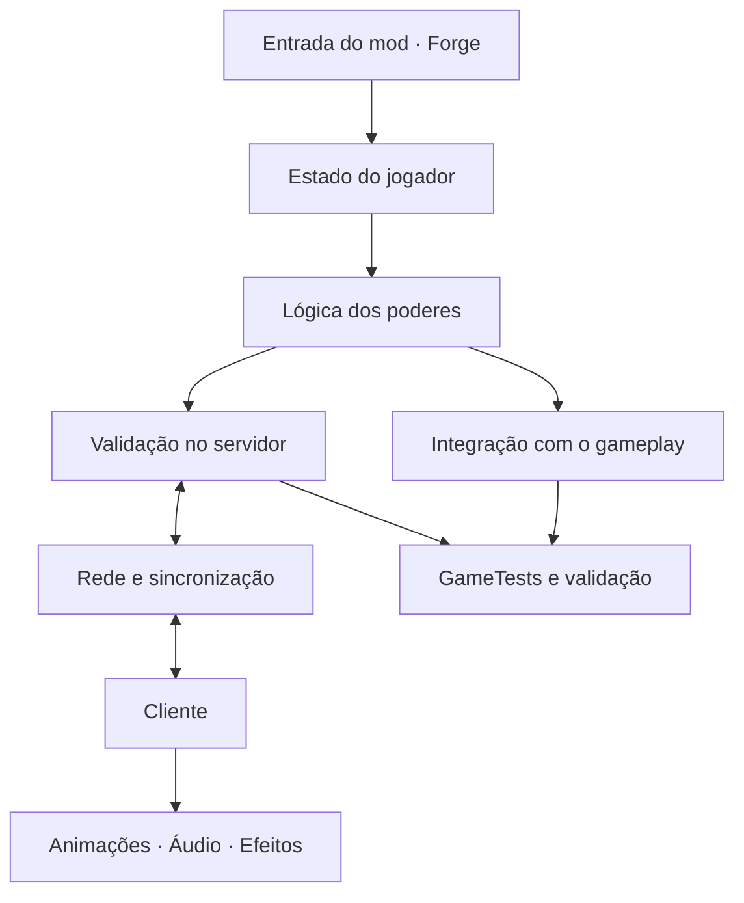

<!--
  ASCENDANT — Superhuman Framework
  README focado em identidade visual, estado real do projeto e onboarding.
-->

<div align="center">

  

  <p>
    <strong>Um framework modular de super-humanos para Minecraft.</strong><br/>
    Poderes construídos para mudar o gameplay — não apenas a aparência.
  </p>

  <p>
    
    
    
    
  </p>

  <p>
    <a href="#-visão-geral">Visão geral</a> •
    <a href="#-estado-atual">Estado atual</a> •
    <a href="#-roadmap-de-poderes">Roadmap</a> •
    <a href="#-compilar-e-testar">Compilar e testar</a> •
    <a href="#-arquitetura">Arquitetura</a>
  </p>

</div>

---

## ✦ Visão geral

**Ascendant** é um projeto em desenvolvimento para criar uma base sólida, extensível e preparada para multiplayer para poderes super-humanos no Minecraft Java 1.20.1.

A proposta é priorizar **poucos poderes com profundidade real** em vez de muitos poderes superficiais. Cada habilidade deve ter comportamento próprio, regras claras, integração com o mundo e validação técnica.

<table>
  <tr>
    <td width="50%">
      <h3>⚡ Gameplay de verdade</h3>
      Habilidades devem alterar movimento, interações ou combate. Partículas e animações complementam a mecânica; não substituem sua implementação.
    </td>
    <td width="50%">
      <h3>🧩 Arquitetura modular</h3>
      Separação entre estado do jogador, lógica dos poderes, integração com Forge, rede e apresentação visual.
    </td>
  </tr>
  <tr>
    <td width="50%">
      <h3>🛡️ Multiplayer em primeiro plano</h3>
      O servidor deve validar mudanças de estado, movimento, dano, permissões e cooldowns. Dados enviados pelo cliente não são confiáveis por padrão.
    </td>
    <td width="50%">
      <h3>🧪 Qualidade verificável</h3>
      Compilação, GameTests e documentação de limitações fazem parte do desenvolvimento — não são etapas opcionais.
    </td>
  </tr>
</table>

## 🚧 Estado atual

> [!IMPORTANT]
> **Ascendant está em estágio inicial.** A base de estado do jogador existe, mas os cinco sistemas de poderes abaixo ainda não são considerados implementados.

### O que já existe

- [x] Projeto configurado para Minecraft 1.20.1, Forge 47.3.0 e Java 17.
- [x] Capability de jogador para armazenar IDs de poderes desbloqueados.
- [x] Persistência do estado em NBT.
- [x] Lógica de cópia do estado nos caminhos tratados por `PlayerEvent.Clone`.
- [x] GameTests para capability, serialização NBT, desbloqueio idempotente e respawn real do servidor após morte e retorno do End.
- [x] Build e GameTest executados com sucesso no ambiente JDK 17 utilizado na validação.

### O que ainda falta

- [x] Testar o ciclo de morte e respawn pelo servidor, incluindo retorno do End; multiplayer com cliente remoto ainda não foi testado.
- [x] Definir políticas de permissão e cooldown; integrar cooldown runtime quando uma habilidade ativa precisar dele.
- [ ] Implementar a primeira habilidade de gameplay: **voo**.
- [ ] Adicionar sincronização de rede quando houver estado real que precise ser compartilhado.
- [ ] Desenvolver e validar os demais poderes.

<details>
  <summary><strong>📌 Como interpretar o status</strong></summary>

  Uma capability de estado não significa que um poder já funciona. O projeto só considera uma habilidade concluída quando sua mecânica, integração com o jogo, comportamento multiplayer e testes relevantes estiverem implementados e validados. A compilação bem-sucedida, isoladamente, não comprova o funcionamento de gameplay.
</details>

## 🦸 Roadmap de poderes

A ordem inicial prioriza a implementação profunda de cinco pilares.

| Prioridade | Sistema | Status | Objetivo |
|:--:|---|:--:|---|
| 01 | **Voo** | 🔄 Próximo | Ativação e desativação reais, controle aéreo, colisões e regras de queda. |
| 02 | **Supervelocidade** | ⏳ Planejado | Movimento acelerado com limites, interação com terreno e controle seguro. |
| 03 | **Superforça** | ⏳ Planejado | Interações e efeitos concretos sobre combate e mundo, validados pelo servidor. |
| 04 | **Super-resistência** | ⏳ Planejado | Mitigação de dano configurável e compatível com diferentes fontes de dano. |
| 05 | **Poderes aquáticos** | ⏳ Planejado | Habilidades próprias para ambientes aquáticos, com regras dentro e fora da água. |

<sub>Os indicadores descrevem a fila de desenvolvimento, não funcionalidades disponíveis para jogadores.</sub>

## 🛠️ Tecnologias

<div align="center">
  
  
  
  
</div>

| Configuração | Valor |
|---|---|
| Minecraft | Java Edition 1.20.1 |
| Forge | 47.3.0 |
| Java | 17 |
| Mod ID | `ascendant` |
| Pacote-base | `br.com.ascendant` |
| Versão inicial | `0.1.0` |

## 🚀 Compilar e testar

### Pré-requisitos

- Windows, Linux ou macOS com ambiente compatível com o projeto.
- **JDK 17** instalado e selecionado no ambiente.
- Git, caso queira clonar o repositório.

### 1. Clonar o projeto

```bash
git clone https://github.com/srkaiohshin-droid/Ascendent.git
cd Ascendent
```

### 2. Selecionar o Java 17 no Windows

O Gradle deve ser executado com JDK 17. Se o terminal estiver apontando para uma versão antiga do Java, configure `JAVA_HOME` e priorize o diretório `bin` dessa instalação no `PATH`.

Exemplo no PowerShell — ajuste o caminho para a instalação real do seu JDK:

```powershell
$env:JAVA_HOME = "C:\\Program Files\\Eclipse Adoptium\\jdk-17"
$env:PATH = "$env:JAVA_HOME\\bin;$env:PATH"
java -version
```

Confirme que a saída indica Java 17 antes de continuar.

### 3. Compilar

No Windows:

```powershell
.\gradlew.bat build
```

No Linux/macOS:

```bash
./gradlew build
```

O artefato compilado deve ser procurado em `build/libs/`.

### 4. Executar os GameTests

No Windows:

```powershell
.\gradlew.bat runGameTestServer
```

No Linux/macOS:

```bash
./gradlew runGameTestServer
```

> [!NOTE]
> Os GameTests cobrem persistência do estado e o ciclo real de respawn do servidor após morte e retorno do End. Não foi executado teste multiplayer com cliente remoto. A tarefa JUnit `test` pode informar `NO-SOURCE` porque não há testes JUnit em `src/test`; isso não substitui os GameTests do Forge.

## 🧱 Arquitetura

A arquitetura evolui junto com as necessidades reais de cada mecânica, evitando abstrações vazias e sistemas criados sem um consumidor concreto.



**Princípios técnicos**

- **Autoridade do servidor:** o cliente envia intenções; o servidor valida e decide os resultados.
- **Separação de responsabilidades:** regras de poderes, persistência, integração Forge, rede e renderização não devem virar uma classe monolítica.
- **Estado explícito:** dados permanentes e temporários devem ter políticas claras para morte, respawn, troca de dimensão e desconexão.
- **Cliente e servidor dedicados:** código exclusivamente visual não deve quebrar o carregamento do servidor.
- **Implementação comprovável:** não declarar uma mecânica funcional sem código, integração e validação compatíveis com a afirmação.

## 📚 Documentação do projeto

| Documento | Conteúdo |
|---|---|
| [`AI_CONTEXT.txt`](AI_CONTEXT.txt) | Identidade, prioridades, restrições e contexto técnico central. |
| [`AGENT_COORDINATION.txt`](AGENT_COORDINATION.txt) | Fila de tarefas, responsáveis e critérios de conclusão. |
| [`AGENT_LOG.txt`](AGENT_LOG.txt) | Histórico de lotes, alterações e validações. |
| [Arquitetura](docs/ARCHITECTURE.md) | Organização técnica e pontos de extensão do Forge. |
| [Desenvolvimento de poderes](docs/POWER_DEVELOPMENT.md) | Critérios para projetar e concluir cada habilidade. |
| [Rede](docs/NETWORKING.md) | Diretrizes de comunicação e validação multiplayer. |
| [Testes](docs/TESTING.md) | Processo de compilação e validação. |

## 🤝 Desenvolvimento

Contribuições, revisões de arquitetura e sugestões técnicas são bem-vindas. Antes de implementar uma tarefa, consulte o contexto central e a fila de coordenação para preservar as decisões do projeto e evitar alterações conflitantes.

1. Entenda o estado real da funcionalidade antes de modificá-la.
2. Prefira lotes coerentes e modulares.
3. Compile e execute os testes relevantes após as mudanças.
4. Registre o que foi alterado, o que foi validado e quais limitações continuam abertas.

---

<div align="center">

  <strong>ASCENDANT</strong><br/>
  <sub>Build powers with purpose. Validate every ability.</sub>

  <br/>

  

</div>
