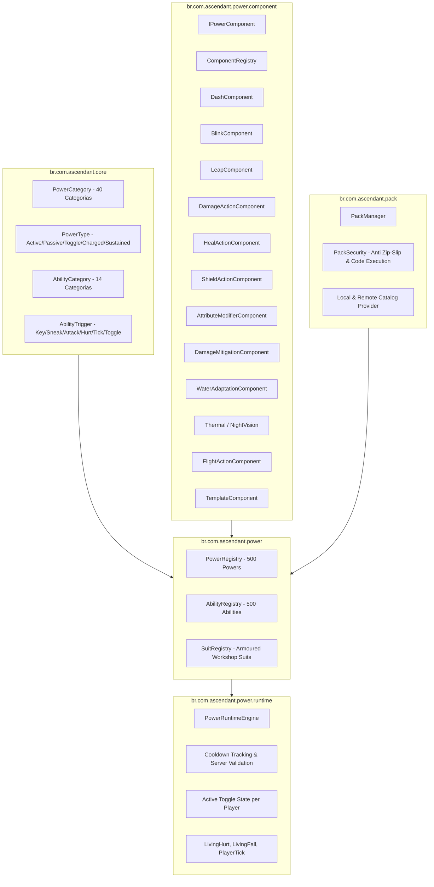

# Ascendant — Development Status & Content Registry Report

> **Target Platform:** Minecraft Java 1.20.1 | Forge 47.3.0 | Java 17 (Temurin 17.0.20.1)  
> **Package Base:** `br.com.ascendant`  
> **Status Date:** 2026-10-20  
> **Build Status:** BUILD SUCCESSFUL (Gradle 8.8, 32/32 GameTests Passing)

---

## 1. Arquitetura Atual

A base do Ascendant foi expandida para um framework modular, server-authoritative e orientado a dados para superpoderes, habilidades, trajes e pacotes de conteúdo (inspirado nos conceitos do Fisk's Superheroes e Armoured Workshop), sem quebrar ou regredir o sistema de voo tridimensional existente.

---

## 2. Métricas de Conteúdo Auditadas

Todos os poderes e habilidades foram auditados pelo `ContentValidator` automatizado em tempo de inicialização e em testes de servidor integrados (`runGameTestServer`).

| Métrica | Quantidade | Observações |
| :--- | :--- | :--- |
| **Total de Poderes Cadastrados** | **500** | Distribuídos entre as 40 categorias oficiais |
| **Poderes Funcionais (Executores Reais)** | **106** | Apoiados por componentes com lógica física, atributos, combate e mobilidade reais |
| **Poderes em Template / Expansão Futura** | **394** | Marcados honestamente com `functional = false` e parâmetros mecânicos detalhados |
| **Total de Habilidades Cadastradas** | **500** | Distribuídas entre as 14 categorias de habilidades |
| **Habilidades Funcionais (Executores Reais)** | **103** | Apoiadas por componentes operacionais testados e validados |
| **Habilidades em Template / Expansão Futura** | **397** | Marcadas honestamente com `functional = false` |
| **Trajes Cadastrados (Armoured Workshop)** | **6** | Classic Ascendant, Speedster Mk-I, Titan Exosuit, Atlantean Regalia, Solar Aegis, Shadow Infiltrator |
| **Erros de Validação / Referências Órfãs** | **0** | Validação automatizada aprovada sem exceções |

---

## 3. Categorias de Poderes e Exemplos Funcionais

Os poderes estão distribuídos rigorosamente em 40 categorias (13 nas primeiras 20 e 12 nas restantes = 500 poderes):

1. **Voo e mobilidade aérea:** `ascendant:flight` (integração direta com o `FlightController` e física 3D), `ascendant:aerobatic_dash`, `ascendant:aerial_launch`.
2. **Supervelocidade e movimento cinético:** `ascendant:kinetic_sprint` (modificador de atributo `generic.movement_speed`), `ascendant:mach_dash`, `ascendant:hyper_leap`, `ascendant:kinetic_dampener`.
3. **Superforça e manipulação física:** `ascendant:titan_strength` (modificador de `generic.attack_damage`), `ascendant:seismic_slam`, `ascendant:colossal_leap`, `ascendant:shockwave_knockback`.
4. **Resistência, invulnerabilidade e regeneração:** `ascendant:diamond_skin` (modificador de `generic.armor`), `ascendant:kinetic_mitigation` (mitigação percentual em `LivingHurtEvent`), `ascendant:fire_immunity`, `ascendant:nanite_regeneration`.
5. **Teletransporte e portais:** `ascendant:blink_step` (teletransporte instantâneo via raycast com aterrissagem segura), `ascendant:spatial_leap`, `ascendant:phase_dash`.
6. **Energia e rajadas:** `ascendant:energy_blast`, `ascendant:energy_burst`, `ascendant:kinetic_pulse`.
7. **Fogo e plasma:** `ascendant:pyroclastic_burst`, `ascendant:fireball_shot`, `ascendant:inferno_resistance`.
8. **Gelo e criocinese:** `ascendant:cryo_blast` (aplicação de freeze ticks e lentidão em área), `ascendant:frost_bite_touch`, `ascendant:subzero_burst`.
9. **Eletricidade e magnetismo:** `ascendant:thunderbolt_strike` (invocação de relâmpago no alvo com autoridade de servidor), `ascendant:static_shock`, `ascendant:electromagnetic_pulse`.
10. **Água e poderes aquáticos:** `ascendant:aquatic_respiration` (respiração subaquática infinita, graça do golfinho e visão), `ascendant:tidal_wave`, `ascendant:water_dash`.
11. **Ar e vento:** `ascendant:gale_blast`, `ascendant:cyclone_leap`, `ascendant:wind_cushion`.
12. **Terra e minerais:** `ascendant:stone_skin_plate`, `ascendant:tremor_shock`, `ascendant:boulder_knockback`.
13. **Plantas e vinhas:** `ascendant:vine_pull` (puxão cinético direcional), `ascendant:spore_cloud`.
14. **Som e ressonância:** `ascendant:sonic_screech`, `ascendant:acoustic_shockwave`, `ascendant:sonic_boost_leap`.
15. **Luz:** `ascendant:solar_healing`, `ascendant:photonic_dash`.
16. **Sombras:** `ascendant:shadow_teleport`, `ascendant:shadow_strike`.
17. **Telecinese:** `ascendant:kinetic_pull`, `ascendant:kinetic_push`, `ascendant:psychic_slam`.
18. **Gravidade:** `ascendant:gravity_leap`, `ascendant:gravitational_slam`, `ascendant:weightlessness_cushion`.
19. **Escudos e barreiras:** `ascendant:kinetic_barrier` (corações de absorção adicionais e resistência), `ascendant:energy_aegis`, `ascendant:reactive_deflection`.
20. **Cura e suporte:** `ascendant:healing_touch`, `ascendant:regeneration_aura`, `ascendant:restorative_surge`.
21. **Sentidos aprimorados:** `ascendant:sonar_pulse`, `ascendant:reflex_boost`.
22. **Visão especial:** `ascendant:night_vision_eyes`, `ascendant:thermal_scan` (efeito glowing em entidades próximas), `ascendant:infrared_toggle`.
23. **Camuflagem e furtividade:** `ascendant:chameleon_dash`, `ascendant:stealth_strike`.
24. **Metamorfose:** `ascendant:beast_leap`, `ascendant:feral_swipe`.
25. **Clones e duplicatas:** `ascendant:clone_dash_decoy`, `ascendant:decoy_burst`.
26. **Invocação:** `ascendant:lightning_elemental_strike`, `ascendant:healing_wisp`.
27. **Armadilhas e minas:** `ascendant:kinetic_mine`, `ascendant:frost_trap_burst`.
28. **Controle de multidões:** `ascendant:staggering_wave`, `ascendant:cryo_lockdown`, `ascendant:sonic_repulsion`.
29. **Manipulação tecnológica:** `ascendant:cybernetic_speed`, `ascendant:nanite_heal_injection`.
30. **Habilidades cósmicas:** `ascendant:stellar_dash`, `ascendant:supernova_blast`.
31. **Poderes psíquicos:** `ascendant:mind_blast`, `ascendant:psychic_push`.
32. **Combate corpo a corpo:** `ascendant:brawler_strength`, `ascendant:haymaker_punch`, `ascendant:uppercut_leap`.
33. **Armas de energia:** `ascendant:energy_shot`, `ascendant:plasma_grenade`.
34. **Defesa reativa:** `ascendant:reactive_shield`, `ascendant:thorns_retaliation`, `ascendant:emergency_teleport`.
35. **Adaptações ambientais:** `ascendant:feather_fall_passive`, `ascendant:lava_skin`, `ascendant:abyssal_lung`.
36. **Exploração:** `ascendant:mountaineer_leap`, `ascendant:expedition_dash`, `ascendant:night_explorer`.
37. **Poderes aquáticos especializados:** `ascendant:atlantean_sovereignty`, `ascendant:hydro_torpedo`, `ascendant:abyssal_pulse`.
38. **Transformação corporal:** `ascendant:titan_mass_form`, `ascendant:graphene_hardening`.
39. **Controle territorial:** `ascendant:seismic_disruption`, `ascendant:concussive_pulse_dome`.
40. **Poderes híbridos:** `ascendant:kinetic_thunder_strike`, `ascendant:blazing_dash`, `ascendant:glacial_shield`.

---

## 4. Catálogo de Trajes (Armoured Workshop)

O módulo `br.com.ascendant.suit` implementa:
- Separação entre aparência e lógica de superpoderes.
- Atributos visuais (`SuitModelInfo`: textura, camada emissiva, paleta primária/secundária, peças modulares e capa).
- Modificadores diretos de atributos de jogador (`AttributeModifier`).
- Concessão dinâmica de poderes e habilidades vinculados ao traje via `SuitManager`.
- Comandos integrados: `/ascendant suit list`, `/ascendant suit equip <player> <suit_id>`, `/ascendant suit unequip <player>`.

---

## 5. Gerenciador de Pacotes e Segurança

O módulo `br.com.ascendant.pack` implementa:
- Diretório de pacotes: `run/ascendant_packs/` (ou `ascendant_packs/` na pasta do jogo).
- Manifesto declarativo versionado (`manifest.json`) com ID, nome, versão, autor, compatibilidade (MC 1.20.1, Forge 47.3.0, Ascendant 0.1.0) e contagem de conteúdo.
- Extração atômica com diretório temporário e rollback em caso de falha.
- **Segurança estrita (`PackSecurity`):**
  - Rejeição de Path Traversal (Zip-Slip) — caminhos contendo `..` ou barras absolutas.
  - Bloqueio completo de arquivos executáveis (`.class`, `.jar`, `.exe`, `.bat`, `.cmd`, `.sh`, `.ps1`, `.js`).
  - Limite de descompressão contra Zip-Bombs (máx 5.000 entradas e 200 MB).
- Exportador de pacotes (`CatalogExporter` / `/ascendant pack export`).

---

## 6. Resultado dos Testes e Build

- **Gradle Build:** `BUILD SUCCESSFUL` (compilação limpa sem erros).
- **GameTests (`runGameTestServer`):** **32/32 testes aprovados** (27 testes preexistentes do voo, mixins e capability preservados com 100% de sucesso + 5 novos testes de integridade do framework).
- **Testes novos cobertos:**
  1. `catalogIntegrityAndCountValidation`: valida contagem de 500 poderes, 500 habilidades e integridade total de referências.
  2. `coreComponentsExecution`: valida impulsão do DashComponent, cura do HealActionComponent e absorção do ShieldActionComponent.
  3. `abilityActivationAndCooldownEnforcement`: valida verificação de permissão, execução da habilidade e bloqueio por cooldown.
  4. `suitEquipGrantsAssociatedPowers`: valida concessão de poderes pelo traje e remoção ao desequipar.
  5. `packSecurityPathTraversalAndExecutableRejection`: valida bloqueio de Zip-Slip e arquivos `.class` executáveis.

---

## 7. Instruções para Continuidade por Próximos Agentes

1. **Adicionar novos poderes ou habilidades:**
   - Adicione novas entradas no `PowerCatalogData` ou `AbilityCatalogData`, ou crie um content pack em `ascendant_packs/`.
   - Se for introduzir uma nova mecânica, crie um novo componente em `br.com.ascendant.power.component` implementando `IPowerComponent` e registre sua fábrica em `ComponentRegistry`.
2. **Executar validação de catálogo e compilação:**
   - Execute `.\gradlew.bat compileJava` para verificar a compilação.
   - Execute `.\gradlew.bat runGameTestServer` para rodar os 32 GameTests automatizados.
